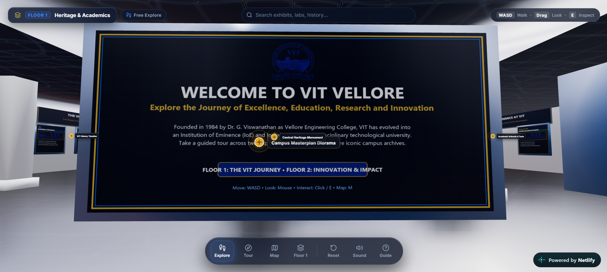
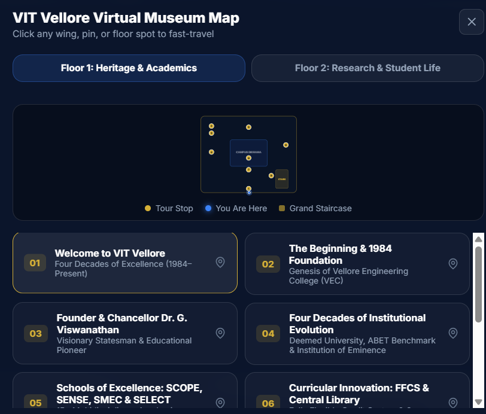
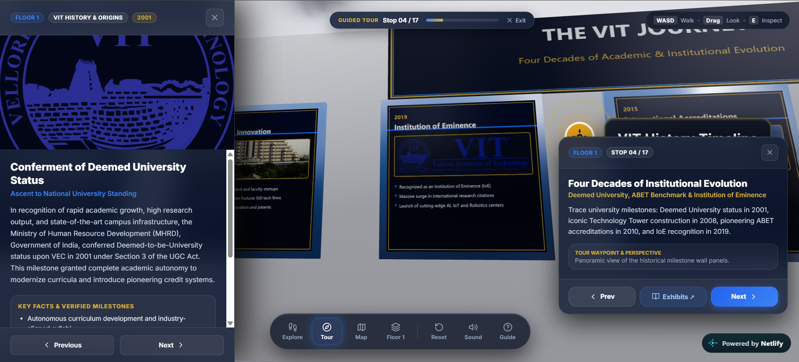
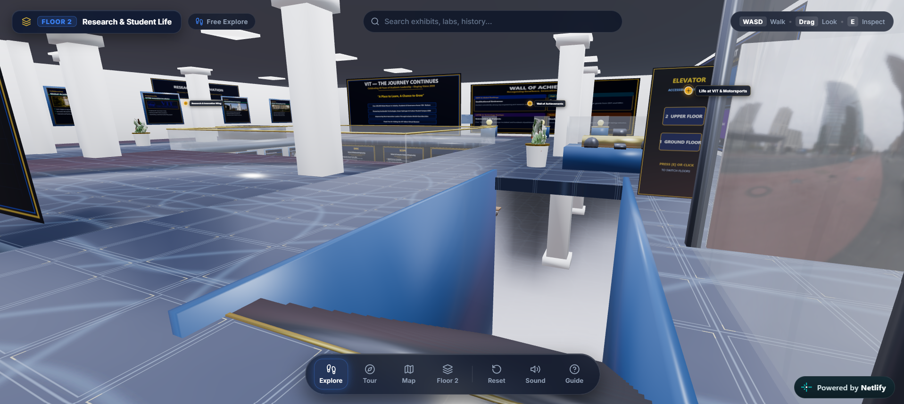

# VIT Vellore Virtual Museum — Two-Floor Interactive 3D Experience (v2.0)

An immersive, cinema-grade 3D digital museum dedicated to **Vellore Institute of Technology (VIT), Vellore**. Built with **React 18**, **React Three Fiber (R3F)**, **Three.js PBR Shading**, **Drei**, **Postprocessing**, **Zustand**, and **Framer Motion**.

The experience allows visitors to explore two floors freely with WASD walking controls, follow a curated 16-stop guided tour, inspect authentic campus photographs, interact with 3D landmark beacons, and study verified university milestones.

---

## What's New in Version 2.0 (R3F Modernization)

1. **Free Walk & Exploration Engine**:
   - **Full WASD & Arrow Keys Movement**: Walk freely anywhere in the museum with smooth acceleration and velocity.
   - **Sprint**: Hold `Shift` to run faster (6.2 m/s).
   - **Architectural Staircase Ramping**: Walk up or down the 16-step grand staircase (`x: [10.2, 14.8], z: [6.6, 14.8]`) with smooth S-curve continuous height interpolation from Floor 1 (`y = 1.6m`) to Floor 2 (`y = 6.6m`).
   - **Mezzanine Atrium Void Protection**: Safeguards prevent walking into the open center of Floor 2.
   - **Mobile Virtual Joystick**: Touch-friendly floating joystick for walking on tablets and mobile screens.

2. **Side-by-Side UI Architecture (Zero Overlap)**:
   - **Exhibit Information Drawer**: Pinned strictly to the **LEFT** side of the screen (`left: 0`).
   - **Tour Stop Guidance Card**: Pinned strictly to the **RIGHT** side of the screen (`right: 24px`).
   - Both panels can be open simultaneously during guided tours without colliding.

3. **High-Fidelity PBR Botanical Vegetation & Furnishings**:
   - **Realistic Potted Plants**: Handcrafted ceramic planters, brass rims, potting soil, and 14 tiered leaf fronds with subsurface light transmission (`MeshPhysicalMaterial`) and procedural wind sway (`useFrame`).
   - **Solid Walnut Museum Benches**: Wooden planks with polished chrome legs and Drei `<ContactShadows />`.

4. **Open Campus Masterplan Diorama**:
   - Removed milky depth-blocking glass.
   - Polished gold gallery stanchions with perimeter LED warm lighting.
   - Drone aerial satellite masterplan of the VIT Vellore campus with miniature 3D building models (Technology Tower, SJT, Periyar Library, Anna Auditorium, Main Gate) and standing photo plinths.

5. **Audio Synthesis & Voice Narration (TTS)**:
   - Web Audio API synthesized interface tones (clicks, transitions, chimes) without external sound assets.
   - Web Speech API text-to-speech (TTS) automated voice guidance for tour stops and exhibits.

---

## How to Run Locally

### Prerequisites
- **Node.js** v18+ or v20+
- **npm** (comes with Node.js)

### 1. Install Dependencies
Run from the project root:
```bash
npm install
```
*(If peer dependency conflicts occur on older npm versions, use `npm install --legacy-peer-deps`)*

### 2. Start the Development Server
```bash
npm run dev
```
Open **[http://localhost:3000/](http://localhost:3000/)** in Google Chrome, Microsoft Edge, Mozilla Firefox, or Apple Safari.

### 3. Production Build & Preview
To create an optimized production bundle:
```bash
npm run build
npm run preview
```

---

## Legacy Fallback (A-Frame 1.5.0)

The original standalone HTML/A-Frame build is preserved in `index.legacy.html`. You can run it via any static HTTP server:

**Using Python:**
```bash
python -m http.server 8000
```
Open `http://localhost:8000/index.legacy.html`.

**Using Node.js:**
```bash
npx http-server -c-1 -p 8000
```

---

## User Controls & Key Bindings

| Key / Input | Action |
|---|---|
| **`W` / `A` / `S` / `D`** | Walk forward, strafe left, backward, strafe right |
| **`Arrow Keys`** | Alternative walk controls |
| **`Shift` (Hold)** | Sprint / run at increased speed (6.2 m/s) |
| **Mouse Drag** | 360° panoramic view / look around |
| **`E` / Left Click** | Inspect closest exhibit / interact with landmark / advance tour |
| **`M`** | Toggle Interactive 2-Floor Vector Blueprint Map |
| **`T`** | Toggle Guided 16-Stop Tour mode |
| **`Space`** | Pause / Resume tour playback |
| **`N` / `Right Arrow`** | Advance to next tour stop |
| **`Q` / `Left Arrow`** | Return to previous tour stop |
| **`H`** | Toggle Minimal HUD mode (hide/show interface overlays) |
| **`Esc`** | Close exhibit drawer, close modals, or exit guided tour |
| **Touch Virtual Joystick** | On-screen mobile thumbstick for free walking |

---

## Interactive 2-Floor Vector Map

Press **`M`** or click **Map** in the dock:
- **Live "You Are Here" Beacon**: Real-time position tracking across both floors.
- **Fast-Travel Teleportation**: Click anywhere on the floor blueprint or numbered tour stop pins to smoothly fly to that spot.
- **Tab Navigation**: Switch between Floor 1 (Heritage & Academics) and Floor 2 (Research & Student Life).

---

## Project Structure

```
virtumuseum/
├── index.html                           # Modern Vite HTML entry point
├── index.legacy.html                    # Original A-Frame 1.5.0 fallback build
├── package.json                         # React 18, Vite 5, R3F, Drei, Zustand dependencies
├── vite.config.js                       # Vite dev server configuration (port 3000)
├── README.md                            # Complete setup & controls guide
├── vit_vellore_virtual_museum.glb       # Optimized two-floor 3D museum model (14.6 MB)
│
├── src/
│   ├── main.jsx                         # React entry point
│   ├── App.jsx                          # Main application layout & UI overlay mounting
│   ├── index.css                        # Modern design system & responsive glassmorphism styles
│   │
│   ├── store/
│   │   └── useMuseumStore.js            # Central Zustand store (mode, floor, tour, exhibits, audio)
│   │
│   ├── components/
│   │   ├── 3d/
│   │   │   ├── MuseumScene.jsx          # Three.js Canvas, HDRI environment, postprocessing bloom
│   │   │   ├── MuseumArchitecture.jsx   # GLB loader, raycasting, shadow casting
│   │   │   ├── CameraController.jsx     # WASD free walk, 2-floor bounds, stairs S-curve, hotkeys
│   │   │   ├── BotanicalPlant.jsx       # PBR ceramic planter with procedural wind-swayed fronds
│   │   │   ├── MuseumBench.jsx          # Walnut wood benches with chrome legs & contact shadows
│   │   │   ├── CampusMasterplanDiorama.jsx # Open gold stanchion diorama with drone aerial map
│   │   │   └── SpatialHotspots.jsx      # Drei 3D HTML pulsing golden radar beacons
│   │   │
│   │   └── ui/
│   │       ├── TopHUD.jsx               # Floor switcher, live search autocomplete, mode pill
│   │       ├── DockToolbar.jsx          # Apple-style bottom dock (Explore, Tour, Map, Sound)
│   │       ├── ExhibitDrawer.jsx        # Pinned LEFT drawer with verified facts & source links
│   │       ├── TourStopCard.jsx         # Pinned RIGHT card for active 16-stop tour step
│   │       ├── MapModal.jsx             # Interactive vector SVG blueprint with player beacon
│   │       ├── VisitorGuideModal.jsx    # Complete controls reference & keyboard cheatsheet
│   │       └── VirtualJoystick.jsx      # Mobile touch thumbstick
│   │
│   ├── utils/
│   │   └── sound.js                     # Web Audio synthesis & Web Speech API TTS engine
│   │
│   ├── data/
│   │   ├── museumContent.js             # Curated 27 exhibits, metadata, and interaction registry
│   │   ├── tourStops.json               # 16-stop guided tour manifest with waypoint coordinates
│   │   └── sources.json                 # Academic provenance & official vit.ac.in links
│   │
│   └── assets/
│       ├── images/vit/                  # Authentic campus photography & aerial drone map
│       └── models/                      # 3D GLB museum model
│
└── scripts/
    ├── generate_vit_museum.py           # Python 3D model generator (pygltflib + trimesh)
    └── export_json.mjs                  # ESM to JSON data exporter
```

---

## How to Add or Update Exhibits

Exhibits are defined in [src/data/museumContent.js](file:///c:/Users/Abhyuday/Documents/..PROJECTS/virtumuseum/src/data/museumContent.js):

```javascript
{
  id: "my-exhibit-id",
  tourStop: 17,
  floor: 1, // 1 or 2
  section: "Academic Foundations",
  title: "Exhibit Title",
  subtitle: "Exhibit Subtitle",
  shortDescription: "Short summary for audio TTS and preview card.",
  description: "Comprehensive historical description...",
  image: "src/assets/images/vit/my_image.jpg",
  imageAlt: "Alt description",
  year: "2026",
  location: "Floor 1 • East Wing",
  facts: [
    "Key verified fact 1",
    "Key verified fact 2"
  ],
  sourceTitle: "Official University Reference",
  sourceUrl: "https://vit.ac.in/",
  position: [12.0, 1.8, -4.0] // 3D world coordinate for nearest exhibit 'E' raycasting
}
```

---

## Implementation Pictures

The implementation screenshots showcase the virtual museum's welcome experience, interactive map, guided tour, and second-floor exhibits.


The welcome screen introduces visitors to the immersive VIT virtual museum experience.


The interactive map helps visitors navigate the museum layout and locate key areas.


The guided tour view presents visitors with contextual information at each museum stop.


The second-floor view highlights the museum's upper-level exhibits and interactive environment.
