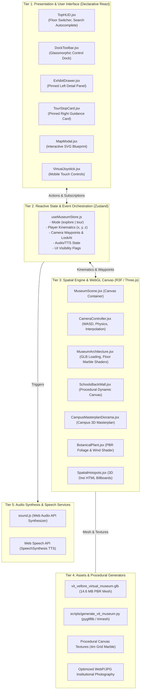
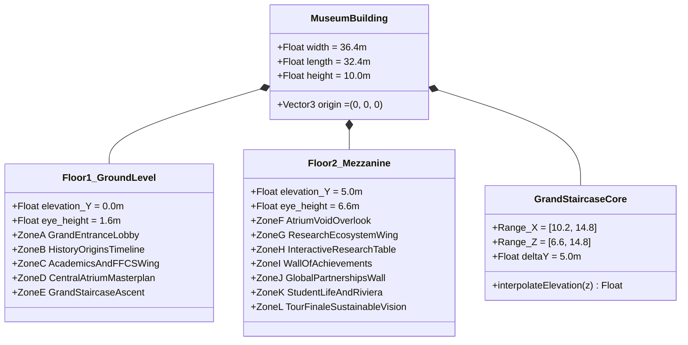
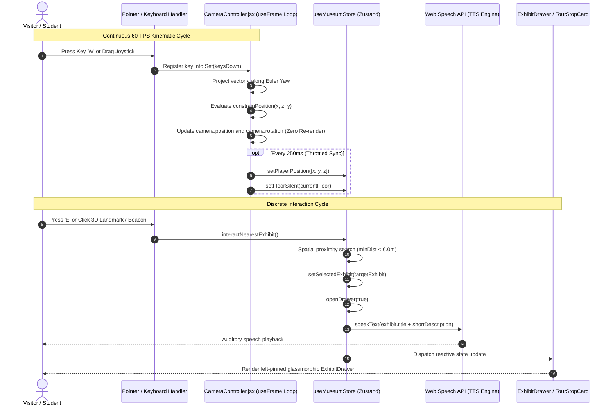

# Project Architecture: Two-Floor Interactive Virtual Museum (v2.0)

**Project Name**: VIT Vellore Virtual Museum  
**Document Classification**: Architectural Technical Specification & System Design  
**Target Repository**: `virtumuseum` (v2.0.0)  

---

## 1. Executive Summary & Architectural Overview

The **VIT Vellore Virtual Museum** is a web-based, cinema-grade, three-dimensional digital twin and institutional heritage installation engineered using **React 18**, **React Three Fiber (R3F)**, **Three.js (WebGL 2.0)**, **Zustand**, and **Vanilla CSS Glassmorphism**. The software architecture provides an interactive, first-person spatial exploration across two distinct museum floors spanning $36.4\,\text{m} \times 32.4\,\text{m} \times 10.0\,\text{m}$, decoupling high-throughput 60-FPS 3D rendering from 2D declarative user interface states and asynchronous audiovisual narration engines.

Traditional virtual tour applications frequently suffer from high latency, monolithic asset delivery, rigid pre-rendered panoramic paths, and fragmented user interface layers. In contrast, this project implements a **Decoupled Model-View-Controller (MVC) Spatial Pipeline**, utilizing:
1. An **Analytical Kinematic Collision Subsystem** replacing expensive triangular raycasting with continuous mathematical polynomial surfaces.
2. A **Zustand-Powered Micro-Store Event Bus** that coordinates spatial waypoints, interactive drawers, floor transitions, and search indexing without triggering cascading React component re-renders.
3. A **Non-Colliding Dual-Pane Presentation Layer** ensuring that 3D scene interactions, 17-stop guided tour narratives, and deep historical documentation operate concurrently without interface occlusion.
4. An **In-Memory Audio Synthesizer & Web Speech TTS Pipeline** providing auditory cues and synthesized voice guidance without external audio bandwidth overhead.

---

## 2. Multi-Tier System Architecture

The project is structured into five distinct operational tiers, each enforcing strict separation of concerns, deterministic lifecycle management, and optimal computational efficiency.

### 2.1 Tier 1: Declarative Interface & View Layer
Built atop React 18, this layer handles all two-dimensional interactive viewports. It does not manipulate the 3D scene graph directly; instead, it subscribes reactively to selected slices of the global Zustand store. CSS Glassmorphism utilizes hardware-accelerated `backdrop-filter: blur(16px)` with semantic dark-slate and gold themes.

### 2.2 Tier 2: State Management & Event Broker
Implemented via `useMuseumStore.js` (Zustand). It isolates high-frequency kinematic updates (such as player coordinates $\vec{p} = [x, y, z]$ throttled to $4\,\text{Hz}$ for the 2D SVG map) from low-frequency transactional events (modal toggling, floor switches, exhibit queries).

### 2.3 Tier 3: 3D Scene Graph & Physics Subsystem
Encapsulated within `@react-three/fiber` and `@react-three/drei`. Execution is governed by an imperative render loop (`useFrame`), executing at the monitor's native refresh rate ($60\,\text{Hz} - 144\,\text{Hz}$). To eliminate garbage collection pauses and React reconciliation overhead, runtime camera transformations are retained in mutable React `useRef` instances rather than reactive component state.

### 2.4 Tier 4: Data Layer & Procedural Texturing
Combines a static JSON manifest ([src/data/tourStops.json](file:///c:/Users/Abhyuday/Documents/..PROJECTS/virtumuseum/src/data/tourStops.json), [src/data/sources.json](file:///c:/Users/Abhyuday/Documents/..PROJECTS/virtumuseum/src/data/sources.json), and [src/data/museumContent.js](file:///c:/Users/Abhyuday/Documents/..PROJECTS/virtumuseum/src/data/museumContent.js)) with procedurally synthesized HTML5 2D canvas textures for luxury dark marble floorings and faculty exhibition backdrops.

### 2.5 Tier 5: Audio & Voice Synthesis Service
Zero-network-overhead acoustic pipeline. Interface auditory feedback (clicks, floor transitions, waypoint chimes) is synthesized directly via Web Audio API oscillators and gain envelopes. Exhibit descriptions and tour stop narrations are rendered asynchronously using the W3C Web Speech API (`window.speechSynthesis`).

---

## 3. Spatial Hierarchy & Architectural Layout

The museum model occupies a total bounding volume of $36.4\,\text{m} \times 32.4\,\text{m} \times 10.0\,\text{m}$, structured as a two-floor open-atrium university heritage installation.

### 3.1 Spatial Zone Allocation

| Floor | Zone Identifier | Spatial Coordinate Extents ($X, Z$ in meters) | Curatorial Theme & Functional Exhibit Items |
|---|---|---|---|
| **Floor 1** | **Zone A** | $X \in [-6.0, 6.0], Z \in [8.0, 16.2]$ | **Grand Entrance & Reception**: Chancellor Dr. G. Viswanathan portrait, welcome statement, interactive directory. |
| **Floor 1** | **Zone B** | $X \in [-18.2, -7.0], Z \in [-15.0, 6.0]$ | **Origins & Historical Chronology (1984–2001)**: Vellore Engineering College foundation, university transformation, ABET milestone. |
| **Floor 1** | **Zone C** | $X \in [7.0, 18.2], Z \in [-15.0, 6.0]$ | **Academic Wings & FFCS**: Flexible Credit System, Periyar Central Library, Administrative Quadrangle. |
| **Floor 1** | **Zone D** | $X \in [-7.0, 7.0], Z \in [-6.0, 5.0]$ | **Central Atrium & Campus Diorama**: Open brass-stanchion diorama with drone aerial map, Technology Tower 3D model, VIT Monolith. |
| **Floor 1** | **Zone E** | $X \in [10.2, 14.8], Z \in [6.6, 14.8]$ | **Vertical Transition Core**: 16-step grand staircase with brass handrails and accessible teleportation elevator. |
| **Floor 2** | **Zone F** | $X \in [-7.2, 7.2], Z \in [-6.2, 5.2]$ | **Atrium Mezzanine Void**: Balcony overlook with glass balustrades and protective boundary collision clamping. |
| **Floor 2** | **Zone G** | $X \in [-18.2, -7.0], Z \in [-15.0, 6.0]$ | **Research Ecosystem**: 50,000+ Scopus papers, DST/ISRO/DRDO grant portfolios, patent statistics. |
| **Floor 2** | **Zone H** | $X \in [-15.0, -9.0], Z \in [-8.0, -3.0]$ | **Specialized Research Centres & Incubator**: Centre for Nanotechnology, CBCMT, Automotive Research, VITTBI startup display. |
| **Floor 2** | **Zone I** | $X \in [-6.0, 18.2], Z \in [-16.2, -12.0]$ | **Wall of Achievements**: NIRF Top 15 rankings, NAAC A++ (CGPA 3.66/4), QS World Rankings, Smart India Hackathon awards. |
| **Floor 2** | **Zone J** | $X \in [-6.0, 6.0], Z \in [6.0, 16.2]$ | **Global Partnerships**: International Relations, 300+ university MoUs, Semester Abroad Program (SAP). |
| **Floor 2** | **Zone K** | $X \in [7.0, 18.2], Z \in [-12.0, 6.0]$ | **Campus Culture & Student Life**: Riviera (ISO 9001 certified), graVITas tech fest, Formula Student racing teams. |
| **Floor 2** | **Zone L** | $X \in [-7.0, 7.0], Z \in [0.0, 5.0]$ | **Tour Finale & Institutional Vision**: Alumni network (200,000+), Vision 2030 sustainable carbon-neutral roadmap. |

---

## 4. Mathematical Modeling of Kinematics & Collisions

To ensure a constant $60\,\text{FPS}$ across both integrated GPUs and high-end workstations, the physics simulation avoids computationally heavy mesh-mesh intersection pipelines. Instead, an analytical kinematic constraint model is evaluated inside the camera update cycle.

### 4.1 First-Person Horizontal Velocity Vector Projection
When the user triggers navigation keys (`W`, `A`, `S`, `D` or arrow keys) or moves the virtual touch joystick, input vectors are translated into horizontal displacements relative to the current camera Euler yaw angle $\psi$:

$$\vec{u}_{\text{forward}} = \begin{bmatrix} -\sin\psi \\ 0 \\ -\cos\psi \end{bmatrix}, \quad \vec{u}_{\text{strafe}} = \begin{bmatrix} \cos\psi \\ 0 \\ -\sin\psi \end{bmatrix}$$

Given inputs $i_{\text{forward}} \in [-1, 1]$ and $i_{\text{strafe}} \in [-1, 1]$, the composite horizontal movement vector $\vec{d}$ is computed:

$$\vec{d} = i_{\text{forward}} \cdot \vec{u}_{\text{forward}} + i_{\text{strafe}} \cdot \vec{u}_{\text{strafe}}$$

$$\vec{v} = \begin{cases} \frac{\vec{d}}{\|\vec{d}\|} \cdot s \cdot \Delta t & \text{if } \|\vec{d}\| > 10^{-4} \\ \vec{0} & \text{otherwise} \end{cases}$$

where:
- $s$ is the walking speed ($3.8\,\text{m/s}$ default, or $6.2\,\text{m/s}$ when `Shift` sprint is active).
- $\Delta t$ is the delta time clamped to $\Delta t \le 0.1\,\text{s}$ to prevent tunneling during frame drops.

### 4.2 Analytical Staircase Elevation (S-Curve Polynomial Interpolation)
The 16-step staircase ascends between coordinates $Z_{\min} = 6.8\,\text{m}$ and $Z_{\max} = 14.5\,\text{m}$ within $X \in [10.2, 14.8]$. Instead of discrete step collisions that cause visual camera jitter, vertical eye elevation $Y_{\text{cam}}$ is governed by a cubic Hermite smoothstep polynomial:

$$t(z) = \text{clamp}\left(\frac{z - Z_{\min}}{Z_{\max} - Z_{\min}},\, 0,\, 1\right)$$

$$S(t) = 3t^2 - 2t^3$$

$$Y_{\text{cam}}(z) = Y_{\text{base}} + S(t) \cdot \Delta Y = 1.6\,\text{m} + S(t) \cdot 5.0\,\text{m}$$

This formulation guarantees $C^1$ continuity (first derivative $\frac{dY}{dz} = 0$ at both $t=0$ and $t=1$), producing a seamless, vibration-free ascent and descent between Floor 1 ($Y = 1.6\,\text{m}$) and Floor 2 ($Y = 6.6\,\text{m}$).

### 4.3 Floor 2 Atrium Cutout Boundary Clamping
To prevent visitors from walking into the open atrium void above Floor 1, a 2D Axis-Aligned Bounding Box (AABB) projection solver is enforced for $Y_{\text{cam}} \ge 4.0\,\text{m}$:

$$\text{Void Domain: } X \in [-7.2, 7.2], \quad Z \in [-6.2, 5.2]$$

If the candidate coordinate $(x', z')$ falls within the void domain, the solver projects the position onto the closest valid gallery perimeter edge:

$$\Delta_L = |x' - (-7.2)|, \quad \Delta_R = |7.2 - x'|, \quad \Delta_T = |5.2 - z'|, \quad \Delta_B = |z' - (-6.2)|$$

$$x_{\text{clamped}} = \begin{cases} -7.2 & \text{if } \min(\Delta_L, \Delta_R, \Delta_T, \Delta_B) = \Delta_L \\ 7.2 & \text{if } \min(\Delta_L, \Delta_R, \Delta_T, \Delta_B) = \Delta_R \\ x' & \text{otherwise} \end{cases}$$

$$z_{\text{clamped}} = \begin{cases} 5.2 & \text{if } \min(\Delta_L, \Delta_R, \Delta_T, \Delta_B) = \Delta_T \\ -6.2 & \text{if } \min(\Delta_L, \Delta_R, \Delta_T, \Delta_B) = \Delta_B \\ z' & \text{otherwise} \end{cases}$$

---

## 5. Render Loop & Event Dispatch Sequence

The interaction flow between user inputs, the Three.js camera controller, the global store, and the UI overlay is visualized in the sequence diagram below.

---

## 6. Procedural Shading & Material Pipeline

To maintain visual realism without saturating GPU memory with 8K raster textures, the architecture incorporates procedural shader synthesis.

### 6.1 Procedural Dark Marble Canvas Texture
Implemented within `MuseumArchitecture.jsx`, a dynamic HTML5 canvas ($1024 \times 1024\,\text{px}$) generates an architectural floor pattern on startup:
1. **Base Slate**: Deep navy-black pigment (`#080c16`).
2. **Organic Marble Veining**: Multi-pass Bezier curves with varying control-point deviations rendered with an 8-pixel Gaussian blur filter.
3. **Architectural Grid Matrix**: Precision $256 \times 256\,\text{px}$ tile boundaries ($4.0\,\text{m} \times 4.0\,\text{m}$ world coordinates) rendered with gold corner accents (`rgba(212, 175, 55, 0.45)`).
4. **World-Space Planar UV Projection**:
   $$u = \frac{x + 19.0}{4.0}, \quad v = \frac{z + 17.5}{4.0}$$
   This planar mapping guarantees that seams across disjointed floor geometry (Floor 1 main slab, Floor 2 north, south, and east mezzanine catwalks) remain mathematically continuous without tiling distortion.

### 6.2 Physically Based Rendering (PBR) Materials
Materials use `THREE.MeshPhysicalMaterial` and `THREE.MeshStandardMaterial` calibrated for an ACES Filmic Tone Mapping curve:
- **Floor Marble**: `roughness = 0.16`, `metalness = 0.08`, anisotropy = 8.
- **Architectural Gold Trims**: `roughness = 0.22`, `metalness = 0.88`, reflective warm brass sheen.
- **Botanical Foliage**: Double-sided translucent fronds utilizing procedural trigonometric wind displacement inside the vertex evaluation loop:
  $$\Delta x = \sin(\omega t + y \cdot k) \cdot A, \quad \omega = 1.8\,\text{rad/s},\, A = 0.02\,\text{m}$$

---

## 7. Architectural Scalability & Modular Extensibility

The decoupled structure permits horizontal expansion without modifying core rendering kernels:
1. **Adding Exhibition Galleries**: New spatial wings can be introduced by appending glTF nodes with the prefix `INTERACT_*` or by adding entries into [src/data/museumContent.js](file:///c:/Users/Abhyuday/Documents/..PROJECTS/virtumuseum/src/data/museumContent.js). The interaction registry automatically resolves clicks via prototype hierarchy traversal.
2. **Extending Guided Tours**: Adding waypoints in [src/data/tourStops.json](file:///c:/Users/Abhyuday/Documents/..PROJECTS/virtumuseum/src/data/tourStops.json) automatically updates the SVG map icons, the Top HUD progress meters, the audio narration queue, and camera cubic-easing trajectories.
3. **Hardware Adaptation**: Automatic DPR throttling (`dpr={[1, 1.25]}`) and selective shadow casting guarantee smooth execution across mobile devices, tablets, and desktop workstations.
