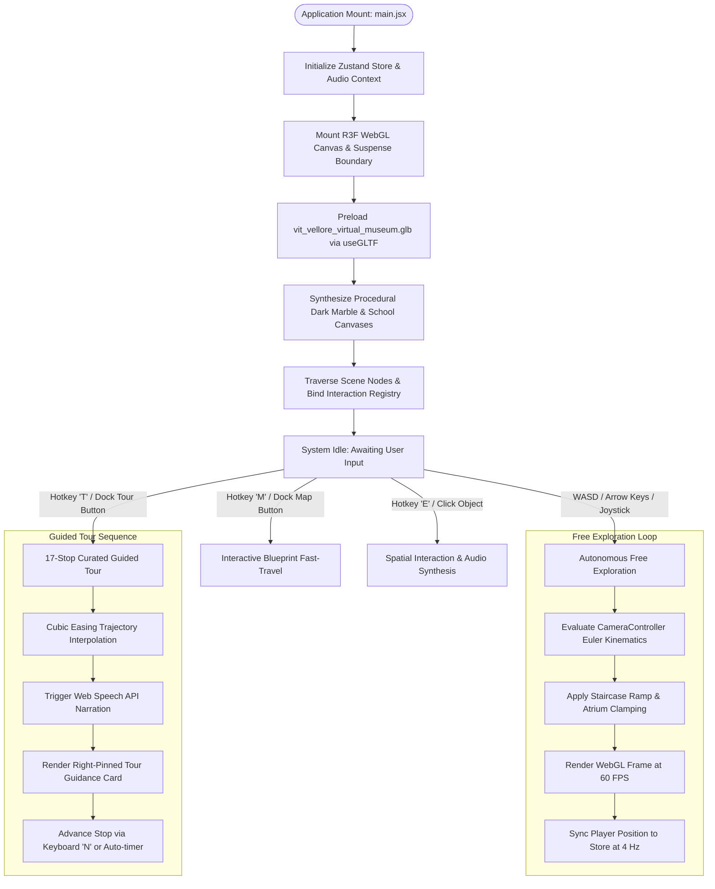
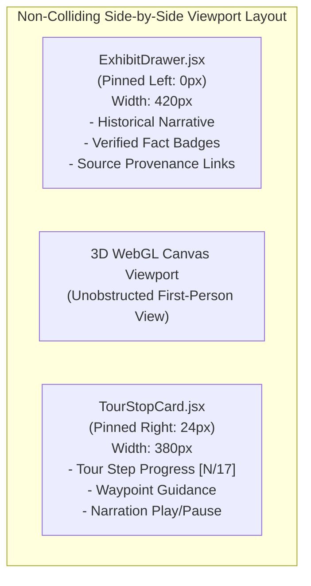

# Project Working & Component Inventory: Two-Floor Interactive Virtual Museum

**Project Name**: VIT Vellore Virtual Museum  
**Document Classification**: Systems Engineering, Component Specifications & Operational Workflow  
**Target Repository**: `virtumuseum` (v2.0.0)  

---

## 1. System Operational Lifecycle & Runtime Workflow

The execution of the VIT Vellore Virtual Museum is structured around an asynchronous hydration lifecycle, transitioning seamlessly into a dual-mode interaction engine.

### 1.1 Initialization & Asynchronous Hydration
1. **Entry Point Mounting**: [src/main.jsx](file:///c:/Users/Abhyuday/Documents/..PROJECTS/virtumuseum/src/main.jsx) mounts `<App />` within the browser's Document Object Model (DOM).
2. **Asset Pre-Hydration**: The primary 3D model asset (`/src/assets/models/vit_vellore_virtual_museum.glb`) is registered with `useGLTF.preload()`. React `<Suspense fallback={null}>` defers rendering until the binary geometry buffers and PBR materials are fully parsed into GPU memory.
3. **Procedural Shading Synthesis**: Before scene activation, procedural canvas buffers generate the 4-meter tile dark marble floor texture and northern academic wall banners.
4. **Scene Graph Optimization**: `MuseumArchitecture.jsx` traverses all glTF scene primitives, adjusting node visibilities to remove obstructing structural pillars around the grand staircase, applying double-sided flags, and mapping UV coordinates.
5. **Event Registration**: Global keyboard, mouse pointer, and resize listeners attach to `window` and `gl.domElement`, establishing responsive input routing.

---

## 2. Comprehensive 3D Graphics Component Specifications

All 3D components reside in `src/components/3d/` and run within the WebGL render pipeline managed by `@react-three/fiber`.

### 2.1 `MuseumScene.jsx` — Scene Root & Environmental Lighting
- **Role**: Root 3D container declaring the `<Canvas>` viewport, projection matrices, postprocessing, and environmental illumination.
- **Canvas Parameters**:
  - `shadows`: Active soft directional shadow maps ($1024 \times 1024\,\text{px}$, bias $-0.0001$).
  - `dpr`: Dynamically bounded device pixel ratio $[1.0, 1.25]$ preventing fill-rate bottlenecks on ultra-high-resolution displays (e.g., Retina / 4K).
  - `camera`: Perspective camera with initial position $(0, 1.6, 15.0)\,\text{m}$, field of view $\text{FOV} = 60^\circ$, near clipping plane $0.1\,\text{m}$, and far clipping plane $180.0\,\text{m}$.
  - `gl`: Explicitly selects `powerPreference: 'high-performance'`, anti-aliasing enabled, and `toneMapping: THREE.ACESFilmicToneMapping` with exposure $1.15$.
- **Lighting Hierarchy**:
  - **Sky Environment**: `<Environment preset="city" environmentIntensity={0.65} />` for realistic PBR ambient reflections.
  - **Ambient Fill**: Soft cool-white (`#e0f2fe`) at $0.55$ intensity.
  - **Key Sun Directional Light**: Positioned at $(6, 14, 8)\,\text{m}$ with intensity $1.2$, illuminating the central atrium and projecting shadows across the diorama and marble floors.
  - **Northern Gallery Fill**: Secondary directional light at $(-4, 10, -10)\,\text{m}$ with intensity $0.7$, balancing illumination on the Wall of Achievements and Schools Back Wall.
  - **Fog**: Exponential distance fog (`#050914`, near $35\,\text{m}$, far $95\,\text{m}$) preventing harsh geometry clipping at building boundaries.

### 2.2 `CameraController.jsx` — Kinematic Navigation & Physics Solver
- **Role**: First-person camera rig implementing zero-re-render WASD walking, mouse look controls, smooth tour waypoint interpolation, and architectural constraints.
- **Data Architecture**:
  - State variables (`position`, `yaw`, `pitch`, `isDragging`, `keysDown`) are stored strictly in mutable React `useRef` instances. This architectural choice prevents unnecessary React virtual DOM diffing during the 60-FPS render cycle.
- **Euler Angle Rotation Engine**:
  - Camera rotation order is configured to `'YXZ'`.
  - Horizontal mouse drag increments yaw: $\psi \leftarrow \psi - \Delta x \cdot k_{\text{sens}}$ ($k_{\text{sens}} = 0.0028\,\text{rad/px}$).
  - Vertical mouse drag increments pitch: $\theta \leftarrow \theta - \Delta y \cdot k_{\text{sens}}$, clamped within $[-1.48, +1.48]\,\text{rad}$ (approximately $\pm 84.8^\circ$) to eliminate gimbal lock.
- **Analytical Constraint Pipeline (`constrainPosition`)**:
  - **Outer Perimeter**: Clamps coordinates to $X \in [-18.2, 18.2]\,\text{m}$ and $Z \in [-16.2, 16.2]\,\text{m}$.
  - **Grand Staircase S-Curve**: For $X \in [10.2, 14.8]$ and $Z \in [6.6, 14.8]$, elevation interpolates smoothly:
    $$t = \text{clamp}\left(\frac{Z - 6.8}{14.5 - 6.8}, 0, 1\right), \quad Y = (3t^2 - 2t^3) \cdot 5.0 + 1.6$$
  - **Floor 2 Atrium Cutout Guard**: For $Y \ge 4.0\,\text{m}$, if $(X, Z)$ enters $[-7.2, 7.2] \times [-6.2, 5.2]$, it is projected onto the nearest boundary edge.
- **Waypoint Trajectory Interpolator**:
  - Employs cubic ease-out interpolation ($\text{ease}(t) = 1 - (1 - t)^3$) across a $1.2$-second duration for smooth transit between tour waypoints.
- **Throttled Store Synchronization**:
  - Updates the player position in the Zustand store every $250\,\text{ms}$ ($4\,\text{Hz}$), supplying coordinate feeds to the 2D vector map without overhead.

### 2.3 `MuseumArchitecture.jsx` — Model Ingestion & Structural Adaptations
- **Role**: Parses `vit_vellore_virtual_museum.glb`, applies procedural materials, resolves raycasting interactions, and augments structural geometry.
- **Traverse & Filter Operations**:
  - Identifies and hides interior structural pillars at $(X \approx 12.0, Z \approx 6.0)$ and dividing walls at $Z \approx 8.5$ that previously obstructed sightlines and staircase access.
  - Hides the original solid glTF Floor 2 East slab and instantiates an open mezzanine structural group with precision cutouts for the 16-step staircase.
- **Procedural Floor Synthesis & Planar UV Mapping**:
  - Invokes `createLuxuryDarkMarbleTexture()` to bind an in-memory $1024 \times 1024$ canvas texture.
  - Re-computes mesh UV coordinates via world-space planar projection ($u = \frac{x+19.0}{4.0}, v = \frac{z+17.5}{4.0}$), ensuring seamless tile alignment across all independent floor slabs.
- **Raycast Event Dispatcher**:
  - Intercepts pointer clicks on GLB geometry, traverses the object prototype ancestry tree to locate matching keys in `INTERACTION_REGISTRY`, and invokes `openExhibitById()`.

### 2.4 `SchoolsBackWall.jsx` — Northern Exhibition Feature Wall
- **Role**: Renders the architectural gallery back wall on Floor 1 ($Z \approx -16.0\,\text{m}$), dedicated to VIT's core academic faculties.
- **Procedural Graphic Synthesis**:
  - Generates a high-density $2048 \times 1024\,\text{px}$ canvas featuring metallic header typography, gold accent borders, and discrete exhibition bays for:
    1. **SCOPE**: School of Computer Science & Engineering (AI, Cloud, Cybersecurity).
    2. **SENSE**: School of Electronics Engineering (VLSI, IoT, 5G Communications).
    3. **SMEC**: School of Mechanical Engineering (Robotics, Automotive ARC, Additive Manufacturing).
    4. **SELECT**: School of Electrical Engineering (Smart Grids, Renewable Energy).
    5. **Multidisciplinary Schools**: BioSciences (SBST), Civil (SCE), Business (VITS), Science & Humanities (SAS/SSL).
- **Interactive Proximity Anchors**:
  - Binds 3D mesh hitboxes allowing visitors to inspect detailed curricula and research statistics for each individual school.

### 2.5 `CampusMasterplanDiorama.jsx` — Architectural Atrium Diorama
- **Role**: Located in the central atrium at $(0.0, 0.0, 4.2)\,\text{m}$, providing an open-air interactive diorama of the 372-acre VIT Vellore campus.
- **Visual Composition**:
  - **Base Plinth**: Dark brushed slate pedestal with warm LED perimeter cove illumination.
  - **Drone Aerial Map**: High-resolution campus satellite map texture mapped onto a horizontal display slab.
  - **3D Miniature Landmark Models**: Precision low-poly architectural representations of iconic campus buildings:
    - *Technology Tower (TT)*: Central multi-tier architectural tower.
    - *Silver Jubilee Tower (SJT)*: Curved contemporary academic complex.
    - *Periyar Central Library*: 6-tier stepped knowledge repository.
    - *Main Administrative Block*: Heritage quadrangle building.
    - *Main Entrance Arch*: Signature university gateway.
  - **Gallery Stanchions**: Polished brass stanchion posts (`roughness: 0.15`, `metalness: 0.92`) enclosing the diorama perimeter.

### 2.6 `BotanicalPlant.jsx` — PBR Foliage & Wind Dynamics
- **Role**: Handcrafted botanical installations positioned throughout lobbies, corridors, and mezzanine balconies.
- **Geometry & Shading**:
  - **Planter Vessel**: Glazed ceramic planter pot with brushed brass rim and dark organic soil plane.
  - **Fronds**: 14 radial tiers of curved palm leaves utilizing `THREE.MeshPhysicalMaterial` with translucent green pigmentation, subsurface transmission, and double-sided rendering.
- **Procedural Wind Sway**:
  - In each render frame (`useFrame`), leaf mesh vertices undergo rotational harmonic oscillation:
    $$\theta_x(t) = \sin(\omega t + \phi) \cdot A, \quad \omega \approx 1.8\,\text{rad/s}$$
    imparting organic visual realism to the museum interior.

### 2.7 `MuseumBench.jsx` — Architectural Rest Areas
- **Role**: Ergonomic gallery seating placed strategically along circulation paths.
- **Construction**: Handcrafted solid American walnut wood slats, polished chrome structural frame, and `@react-three/drei` `<ContactShadows />` for grounded ambient occlusion without heavy real-time shadow computation.

### 2.8 `SpatialHotspots.jsx` — 3D Spatial Radar Beacons
- **Role**: Renders animated golden beacon rings at key exhibit coordinates using Drei's `<Html transform>` abstraction.
- **Behavior**:
  - Billboarded elements orient automatically toward the camera.
  - Radiates CSS pulse animations (`@keyframes pulse-ring`).
  - Clicking a beacon immediately opens the corresponding exhibit drawer and triggers voice narration.

---

## 3. Declarative 2D User Interface Components

The 2D interface layer is engineered with responsive vanilla CSS glassmorphism, maximizing readability while preserving unobstructed views of the 3D scene.

### 3.1 `ExhibitDrawer.jsx` — Pinned Left Information Drawer
- **Placement**: Fixed to `left: 0`, spanning full viewport height with width $420\,\text{px}$.
- **Design Philosophy**: Positioned strictly on the left to ensure zero visual overlap with the right-pinned tour guidance card during active tours.
- **Content Structure**:
  - High-resolution archival photograph or institutional diagram.
  - Exhibit metadata header: Title, Subtitle, Year, and Section badge.
  - Verified fact checklist extracted from official institutional records.
  - Academic provenance footer containing clickable outbound links to `vit.ac.in` and accreditation registries.
  - Action buttons: Read aloud (Web Speech TTS toggle) and Close (`Esc`).

### 3.2 `TourStopCard.jsx` — Pinned Right Guided Tour Guidance Card
- **Placement**: Fixed to `right: 24px, bottom: 96px`, with width $380\,\text{px}$.
- **Functionality**:
  - Displays the active waypoint ordinal (e.g., `Stop 07 of 17`).
  - Displays curated tour stop descriptions and waypoint directional notes.
  - Navigation controls: Previous Stop (`Q`), Pause/Play (`Space`), and Next Stop (`N`).
  - Progress bar dynamically visualizing tour completion percentage.

### 3.3 `TopHUD.jsx` — Header Status & Navigation Toolbar
- **Components**:
  - **Brand Badge**: Official institutional insignia seal and version indicator (`v2.0`).
  - **Floor Switcher**: Toggle button allowing instant floor transitions between Floor 1 and Floor 2 with audible feedback.
  - **Search Autocomplete**: Live filter input querying `MUSEUM_EXHIBITS` by title, keywords, and section; selecting an entry smoothly teleports the camera to the exhibit coordinates.
  - **Minimal HUD Switch**: Hotkey `H` toggle to hide all interface chrome for unobstructed cinematic viewing.

### 3.4 `DockToolbar.jsx` — Glassmorphic Control Dock
- **Design**: Centered at `bottom: 24px`, inspired by modern desktop dock paradigms.
- **Triggers**:
  - `Explore`: Switches to free-walk mode.
  - `Guided Tour`: Initializes the 17-stop tour sequence.
  - `Blueprint Map`: Opens the 2D interactive vector map modal (`M`).
  - `Visitor Guide`: Opens the keyboard controls and shortcut modal (`?`).
  - `Audio / TTS`: Toggles interface audio effects and text-to-speech voice narration.

### 3.5 `MapModal.jsx` — 2D Interactive Blueprint & Fast-Travel Engine
- **Engine**: Pure SVG vector blueprint of Floor 1 and Floor 2 layouts.
- **Features**:
  - **Live Player Beacon**: Real-time pulsing marker updating from `playerPosition` store coordinates.
  - **Tour Waypoint Pins**: Numbered golden beacons corresponding to all 17 tour stops.
  - **Fast-Travel Teleportation**: Clicking any spatial room or waypoint pin instantly dispatches `flyTo(pos, lookAt)`, triggering a smooth camera transition to that location.

### 3.6 `VirtualJoystick.jsx` — Mobile Touch Thumbstick
- **Target**: Touchscreen devices (smartphones and tablets).
- **Implementation**: Binds `touchstart`, `touchmove`, and `touchend` events to calculate a normalized 2D displacement vector $(x, y) \in [-1, 1]^2$, injected directly into the camera kinematic update loop.

---

## 4. State Store & Audio Synthesis Services

### 4.1 Central Zustand Store (`src/store/useMuseumStore.js`)
The reactive heartbeat of the system. State is segregated into:
- **Navigation State**: `floor` (1 | 2), `mode` (`'explore'` | `'tour'`), `playerPosition` ($[x, y, z]$), `cameraTarget` ($\{\text{position}, \text{lookAt}\}$).
- **Tour State**: `tourStops` (array of 17 waypoints), `currentStopIdx` ($0 \dots 16$), `tourPlaying` (boolean).
- **Overlay State**: `selectedExhibit`, `isDrawerOpen`, `isMapOpen`, `isGuideOpen`, `isMinimalHUD`.
- **Audio Configuration**: `audioMuted` (boolean), `ttsEnabled` (boolean).

### 4.2 Web Audio Synthesis & Speech Engine (`src/utils/sound.js`)
- **Zero Asset Dependency**: Does not require loading external `.mp3` or `.wav` sound files over the network.
- **Synthetic Sound Design**:
  - `sound.click()`: High-frequency sine wave pulse ($800\,\text{Hz} \to 400\,\text{Hz}$) over $40\,\text{ms}$ with exponential decay.
  - `sound.teleport()`: Multi-oscillator harmonic chime ($523.25\,\text{Hz} \to 659.25\,\text{Hz} \to 783.99\,\text{Hz}$, C-E-G major triad) simulating spatial arrival.
- **Speech Synthesis (TTS)**:
  - Invokes `window.speechSynthesis` with optimized pitch ($1.0$), rate ($1.02$), and preferred voice heuristics prioritizing natural English accents.
