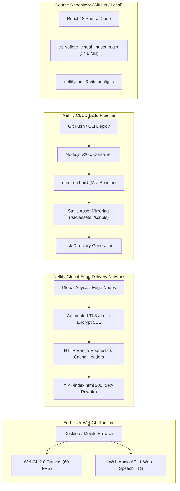
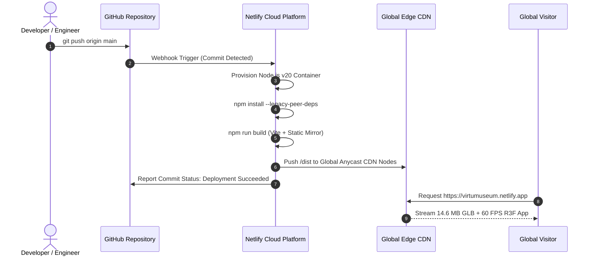

# Netlify Deployment Implementation Plan & Production Guide

**Project Name**: VIT Vellore Virtual Museum  
**Document Classification**: DevOps Engineering, Cloud Hosting & CI/CD Deployment Specification  
**Target Platform**: Netlify (JAMstack Edge CDN)  
**Target Repository**: `virtumuseum` (v2.0.0)  

---

## 1. Executive Deployment Architecture

The **VIT Vellore Virtual Museum** is designed as a high-performance Single Page Application (SPA). To deliver cinema-grade 3D graphics with low initial latency across global geographic regions, the production build is deployed to **Netlify's Global Edge Application Network**.



### Key Architectural Requirements for Netlify
1. **HTTPS Enforcement**: The W3C `Web Speech API` (`speechSynthesis`) and `AudioContext` autoplay policies are strictly governed by browser security contexts. Netlify's automated Let's Encrypt TLS certificate ensures that speech narration and procedural synthesis initialize without browser security restrictions.
2. **HTTP Range Support (Byte Serving)**: The primary 3D binary model (`vit_vellore_virtual_museum.glb`, $14.6\,\text{MB}$) requires HTTP 206 Partial Content responses to facilitate streaming decompression. Netlify Edge natively supports byte-range requests.
3. **Single Page Application Routing**: All dynamic URL paths must be internally rewritten to `/index.html` with an HTTP 200 status.

---

## 2. Pre-Deployment Asset Pipeline Optimization

### 2.1 The Vite Production Asset Resolution Challenge
In development mode (`npm run dev`), the Vite development server serves filesystem assets directly from relative paths such as `/src/assets/models/vit_vellore_virtual_museum.glb` and `/scripts/generated_textures/tex_campus_map.png`.

However, during a production build (`vite build`), Rollup only packages files that are either:
1. Directly imported into JavaScript via ESM syntax (`import modelUrl from '...'`), or
2. Located within Vite's configured `publicDir` (default: `public/`).

If deployed without asset mapping, requests for the 3D GLB model and photography textures will return `404 Not Found`.

### 2.2 Recommended Build Configuration
To guarantee zero missing assets without altering existing component source paths, configure an automated asset mirror in the build process via `package.json` and `netlify.toml`.

#### Option A: Build Script Mirroring (Zero Code Changes — Recommended)
Update the build script in [package.json](file:///c:/Users/Abhyuday/Documents/..PROJECTS/virtumuseum/package.json) to copy the required runtime assets into `dist/` upon build completion:

```json
{
  "scripts": {
    "dev": "vite",
    "build": "vite build && npm run postbuild",
    "postbuild": "node -e \"const fs = require('fs'); fs.cpSync('src/assets', 'dist/src/assets', {recursive: true}); if(fs.existsSync('scripts/generated_textures')) fs.cpSync('scripts/generated_textures', 'dist/scripts/generated_textures', {recursive: true}); fs.copyFileSync('vit_vellore_virtual_museum.glb', 'dist/vit_vellore_virtual_museum.glb');\"",
    "preview": "vite preview"
  }
}
```

#### Option B: Vite Static Copy Plugin
Alternatively, install `vite-plugin-static-copy`:
```bash
npm install -D vite-plugin-static-copy
```
and integrate it into [vite.config.js](file:///c:/Users/Abhyuday/Documents/..PROJECTS/virtumuseum/vite.config.js):
```javascript
import { defineConfig } from 'vite';
import react from '@vitejs/plugin-react';
import { viteStaticCopy } from 'vite-plugin-static-copy';

export default defineConfig({
  plugins: [
    react(),
    viteStaticCopy({
      targets: [
        { src: 'src/assets/*', dest: 'src/assets' },
        { src: 'scripts/generated_textures/*', dest: 'scripts/generated_textures' },
        { src: 'vit_vellore_virtual_museum.glb', dest: '' }
      ]
    })
  ],
  assetsInclude: ['**/*.glb', '**/*.gltf', '**/*.png', '**/*.jpg'],
  server: { port: 3000, open: true }
});
```

---

## 3. Netlify Configuration Specification (`netlify.toml`)

Create a `netlify.toml` file in the project root directory. This file dictates the build environment, headers, asset caching, and SPA redirect rules.

```toml
# ==========================================
# Netlify Production Configuration
# Project: VIT Vellore Virtual Museum (v2.0)
# ==========================================

[build]
  command = "npm run build"
  publish = "dist"

[build.environment]
  NODE_VERSION = "20"
  NPM_FLAGS = "--legacy-peer-deps"

# Single Page Application (SPA) Client Routing Rewrite
[[redirects]]
  from = "/*"
  to = "/index.html"
  status = 200

# High-Performance Caching & Security Headers
[[headers]]
  for = "/*"
  [headers.values]
    X-Frame-Options = "DENY"
    X-Content-Type-Options = "nosniff"
    Referrer-Policy = "strict-origin-when-cross-origin"
    Permissions-Policy = "camera=(), microphone=(), geolocation=(), autoplay=(self)"

# Long-term Caching for Immutable JavaScript & CSS Bundles
[[headers]]
  for = "/assets/*"
  [headers.values]
    Cache-Control = "public, max-age=31536000, immutable"

# Optimized Delivery for 3D GLB Binary Models
[[headers]]
  for = "/*.glb"
  [headers.values]
    Content-Type = "model/gltf-binary"
    Cache-Control = "public, max-age=604800, stale-while-revalidate=86400"
    Access-Control-Allow-Origin = "*"
    Accept-Ranges = "bytes"

[[headers]]
  for = "/src/assets/models/*.glb"
  [headers.values]
    Content-Type = "model/gltf-binary"
    Cache-Control = "public, max-age=604800, stale-while-revalidate=86400"
    Access-Control-Allow-Origin = "*"
    Accept-Ranges = "bytes"

# Image and Texture Asset Caching
[[headers]]
  for = "/src/assets/images/*"
  [headers.values]
    Cache-Control = "public, max-age=2592000, immutable"
```

---

## 4. Step-by-Step Deployment Workflows

You can deploy the project using either **Continuous Deployment via GitHub (Workflow 1)** or **Instant Terminal Deployment via Netlify CLI (Workflow 2)**.

---

### Workflow 1: Continuous Deployment via Git Repository (Recommended)

This workflow enables automated preview builds on every Pull Request and production deployments on every commit to `main`.



#### Step 1: Initialize Git & Push to Remote
Ensure all project code is committed to GitHub, GitLab, or Bitbucket:
```bash
git add .
git commit -m "chore: prepare codebase for Netlify production deployment"
git push origin main
```

#### Step 2: Connect Repository on Netlify
1. Log in to [app.netlify.com](https://app.netlify.com/).
2. Click **"Add new site"** $\to$ **"Import an existing project"**.
3. Choose **GitHub** and authorize access.
4. Select the repository: `virtumuseum` (or `Augmented-Reality-Project`).

#### Step 3: Configure Build & Deploy Settings
Netlify will automatically detect configuration settings from `netlify.toml`. Verify the following parameters:
- **Branch to deploy**: `main`
- **Base directory**: *(Leave empty / project root)*
- **Build command**: `npm run build`
- **Publish directory**: `dist`
- **Node.js Version**: Ensure Environment Variable `NODE_VERSION` is set to `20`.

#### Step 4: Trigger Initial Deployment
Click **"Deploy site"**. The deployment log will stream the build output. Within $45\text{--}70$ seconds, your site will be live at:
`https://<your-custom-site-name>.netlify.app`

---

### Workflow 2: Instant Terminal Deployment via Netlify CLI

If you do not wish to link a remote Git repository immediately, you can deploy directly from your local terminal.

#### Step 1: Install Netlify CLI
Run globally using npm:
```bash
npm install -g netlify-cli
```
Verify the installation:
```bash
ntl --version
```

#### Step 2: Authenticate with Netlify
```bash
ntl login
```
This command opens your browser to authorize the CLI token.

#### Step 3: Compile Production Bundle Locally
Run the build command from the project root:
```bash
npm run build
```
Verify that the `dist/` folder contains `index.html`, `assets/`, and the static model/image assets.

#### Step 4: Initialize & Deploy to Production
Run the deployment command:
```bash
ntl deploy --prod --dir=dist
```
- If prompted to link a site: Choose **"Create & configure a new site"**.
- Select your Netlify team account.
- Specify site name (e.g., `vit-vellore-virtual-museum`).
- Confirm publish directory as `dist`.

The terminal will return your live production URL:
```text
✔ Deploying to main site URL...
Website URL:       https://vit-vellore-virtual-museum.netlify.app
Unique Deploy URL: https://6625...--vit-vellore-virtual-museum.netlify.app
```

---

## 5. Post-Deployment Verification & Smoke Testing Checklist

After the deployment completes, conduct the following validation steps on the live URL:

| Test Item | Verification Procedure | Expected Result | Pass/Fail |
|---|---|---|---|
| **1. WebGL Initialization** | Open the live Netlify URL on Chrome/Edge with DevTools Console open. | 3D Canvas mounts without WebGL context loss or shader compilation errors. | [ ] |
| **2. 3D Model Ingestion** | Inspect Network tab filtering for `.glb`. Verify response code. | `vit_vellore_virtual_museum.glb` returns **HTTP 200** or **HTTP 206 (Partial Content)**. | [ ] |
| **3. Procedural Marble Floors** | Visually inspect Floor 1 and Floor 2 ground planes. | Dark navy marble with gold grid accents renders smoothly across all wings. | [ ] |
| **4. Campus Diorama Satellite Map** | Walk to coordinate $(0, 0, 4.2)$ in the central atrium. | High-res drone satellite map and building plinths render on display table. | [ ] |
| **5. Grand Staircase Traversal** | Walk using `W` across $X \in [10.2, 14.8], Z \in [6.6, 14.8]$. | Camera elevation transitions smoothly from $1.6\,\text{m}$ to $6.6\,\text{m}$ without clipping. | [ ] |
| **6. Web Audio Synthesis** | Click any button in Dock Toolbar or Top HUD. | Crisp synthesized click pulse audible through device speakers. | [ ] |
| **7. Web Speech API (TTS)** | Press `T` to initialize guided tour or click an exhibit beacon. | Voice synthesizer narrates tour stop title and historical summary. | [ ] |
| **8. 2D Vector Blueprint Map** | Press `M` to toggle vector map modal. | Floor 1 / Floor 2 blueprints display with active pulsing player beacon. | [ ] |
| **9. Fast-Travel Teleportation** | Click any tour stop pin on the SVG blueprint. | Camera flies smoothly along ease-out cubic curve to selected coordinates. | [ ] |
| **10. Mobile Touch Joystick** | Open URL on iOS Safari or Android Chrome. | Virtual thumbstick appears at bottom left; dragging navigates camera smoothly. | [ ] |

---

## 6. Troubleshooting & Operational Runbook

### Issue 1: 3D Model Returns 404 on Live Site
- **Symptom**: Black screen with loading spinner; console displays `Failed to load resource: the server responded with a status of 404 (Not Found) for ...glb`.
- **Root Cause**: The Vite production build did not include the raw GLB binary in `dist/`.
- **Resolution**:
  1. Verify that `vit_vellore_virtual_museum.glb` is copied into `dist/src/assets/models/` and `dist/`.
  2. Confirm `netlify.toml` has `publish = "dist"`.
  3. Ensure the `postbuild` script executed during CI/CD.

### Issue 2: Audio Fails to Play on First Click
- **Symptom**: Interface clicks or TTS narration silent until multiple interactions occur.
- **Root Cause**: Modern browser Autoplay Policies block `AudioContext` until an explicit user interaction (click/tap) on the window.
- **Resolution**: The project automatically resumes `AudioContext` on the first pointerdown event in `sound.js`. Verify `Permissions-Policy = "autoplay=(self)"` is present in `netlify.toml`.

### Issue 3: Text-to-Speech (TTS) Silent on Certain Browsers
- **Symptom**: Visual UI works, but speech narration does not play on Firefox or specific Linux distributions.
- **Root Cause**: The client operating system lacks pre-installed speech synthesizer synthesis voices for the requested locale.
- **Resolution**: `sound.js` includes automated fallback voice resolution that queries `window.speechSynthesis.getVoices()` asynchronously and defaults gracefully without throwing exceptions.

### Issue 4: Netlify Build Memory Overflow
- **Symptom**: Netlify deployment fails during build with `JavaScript heap out of memory`.
- **Root Cause**: Node default memory limit ($1.5\,\text{GB}$) exceeded during Rollup chunk analysis.
- **Resolution**: Add an environment variable in `netlify.toml`:
  ```toml
  [build.environment]
    NODE_OPTIONS = "--max-old-space-size=4096"
  ```
